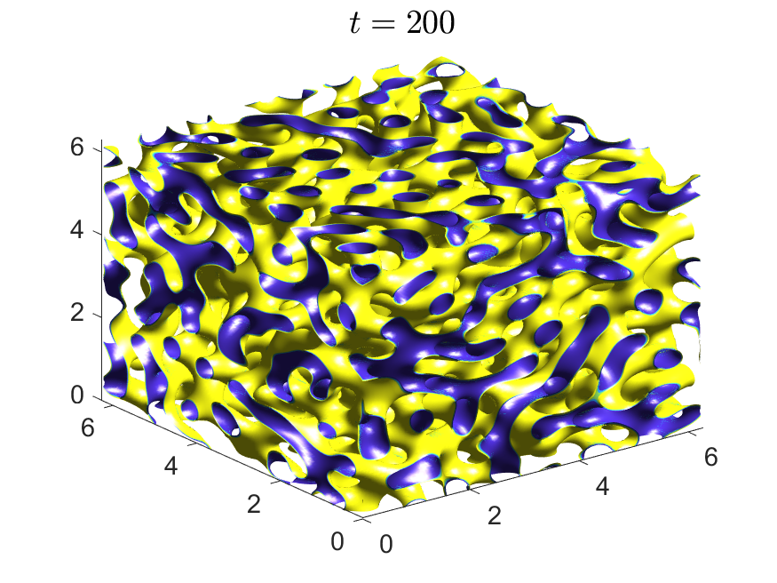
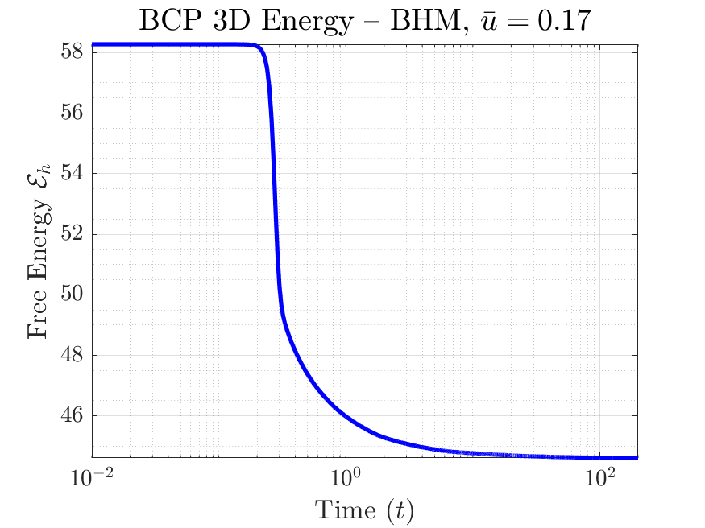
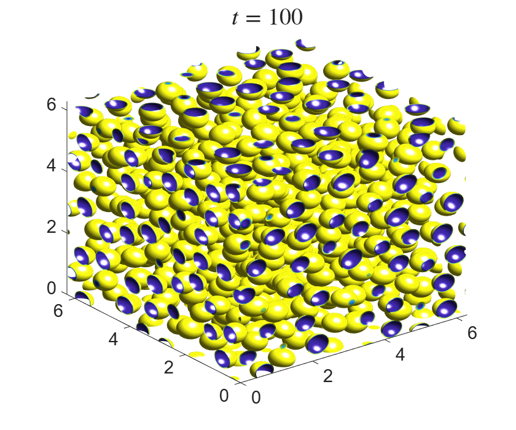
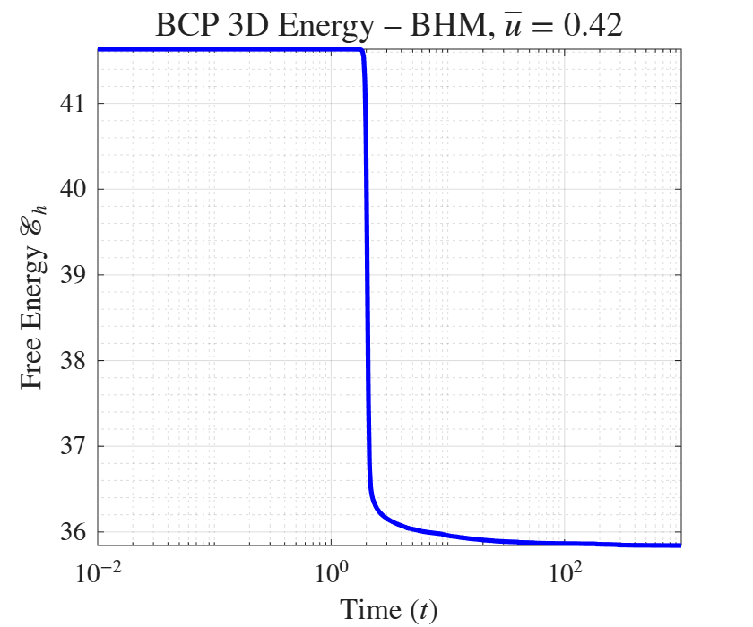

# 3D Phase-Field Simulations : 512^3 via GPU on a Laptop

# BHM-BCP-LargeScale3D
Companion code for an efficient computational framework for large-scale 3D block copolymer (BCP) simulations with the Biharmonic-Modified (BHM) scheme in MATLAB. The repository includes the production solver, the convergence studies in time and space, a controlled comparison with convex splitting (CS) and scalar auxiliary variable (SAV) methods, CPU and GPU benchmarks, a single- versus double-precision study, and long-time simulations at N = 512³ in double precision on a single laptop GPU.

# Why BHM?
BHM is a linear, semi-implicit scheme that requires neither a convex–concave splitting of the energy nor an auxiliary variable. With a Fourier pseudo-spectral discretization, each time step costs one forward and one inverse FFT, and the free energy is evaluated through Parseval's identity at no additional FFT cost. In our comparison, BHM attains the accuracy of SAV at the computational cost of CS, and the nested implementation runs a 512³ double-precision simulation with a peak GPU memory of about 11.2 GiB.
Companion code for: Orizaga et al. (2026), *Engineering With Computers - Springer* (under review).

## Requirements
- MATLAB with the Parallel Computing Toolbox (tested with R2021a and R2026a; recent NVIDIA GPUs such as the RTX 50 series require R2026a)
- An NVIDIA GPU with CUDA support
- GPU memory: about 12 GB for N = 512³ in double precision; smaller grids (64³–256³) run on GPUs with 6 GB or less

## Contents
- `BCP3D_Dynamics.m`: Main BCP simulation with energy diagnostics (isosurfaces, free energy, and relative energy rate). The largest grid depends on the GPU memory: about 12 GB for N = 512³ in double precision, and much less for N ≤ 256³.
- `NewBenchmark_BCP3D.m`: CPU and GPU benchmark (N = 64³, 128³, 256³; 10,000 time steps).
- `SingleVsDouble_BCP3D_Revised.m`: Single- versus double-precision comparison (mass drift and field difference).
- `BCP2D_Spatial_Convergence.m`: Spatial convergence study.
- `BCP2D_Scheme_Comparison.m`: Accuracy comparison of BHM, CS, and SAV.
- `BCP3D_Scheme_Cost.m`: Time and memory comparison of BHM, CS, and SAV in 3D.
- `BCP3D_BHM_Regular_vs_Nested.m`: Memory comparison of the regular and nested BHM implementations.


## Usage
```matlab
% Run simulation
CH3D_GPU_project_2026_BCP(dt, M1, iter, tfinal, N)

% Example parameters
dt=0.01; M1=7.5; tfinal=100; N=256;
```
## Output
Running the code: **BCP3D_Dynamics.m** <br>
will generate the following plot ($\alpha$ =15 and ubar = 0.17 volume fraction)

 

## Output
Running the code: **BCP3D_Dynamics.m** <br>
will generate the following plot ($\alpha$ = 15 and ubar = 0.42 volume fraction)

 


## Citation

If you use this code, please cite:

Orizaga,  S. Gonzalez-Parra, G., Fabien, M.,  Owusu, S. (2026).
“An Efficient Computational Framework for Large-Scale Three-Dimensional Block Copolymer Simulations”
Manuscript submitted to Engineering with Computers - Springer.

Code available at:
https://github.com/sauloorizaga/BHM-BCP-LargeScale3D/
### Historical Note:
The BHM methodology was originally developed to resolve the numerical challenges of variable-mobility Cahn-Hilliard equations. However, our research [[Orizaga & Witelski, 2024]](https://www.sciencedirect.com/science/article/pii/S0927025624003665) demonstrated that the scheme provides superior memory efficiency even for constant-mobility systems. This work extends that benefit to the 3D Block Copolymer (BCP) model, leveraging the scheme's minimal memory footprint to break the 512^3 barrier on consumer GPUs.
 
## Contact
We welcome questions, feedback, and potential collaboration opportunities—feel free to reach out! <br>

**Saulo Orizaga** — saulo.orizaga@nmt.edu  <br>
Associate Professor of Mathematics          <br>
New Mexico Institute of Mining and Technology  <br>
Socorro, NM 87801, USA.
